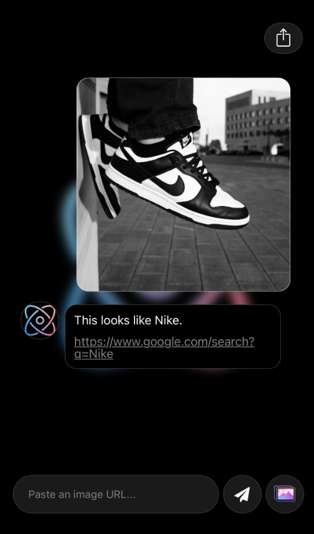

# Yogo App

Yogo is a cross-platform mobile app built with [Expo](https://expo.dev) and React Native, paired with a companion backend server.

[Test your Yogo here!](https://darkslateblue-meerkat-555658.hostingersite.com/)

## Tech Stack

- **Framework:** [Expo](https://expo.dev) `~54` / React Native `0.81.5` / React `19.1.0`
- **Routing:** [Expo Router](https://docs.expo.dev/router/introduction/) (file-based routing)
- **Styling:** [NativeWind](https://www.nativewind.dev/) (Tailwind CSS for React Native)
- **Language:** TypeScript
- **Navigation:** React Navigation (bottom tabs)
- **Media / Storage:** `expo-image-picker`, `expo-file-system`, `expo-image`
- **Environment variables:** `react-native-dotenv`
- **Backend:** Node-based server (see [`/server`](./server))
- **Linting / Formatting:** ESLint, Prettier

## Project Structure

```
Yogo-App/
├── app/              # App screens & file-based routes (Expo Router)
├── assets/images/    # Static image assets
├── server/           # Backend server
├── app.json          # Expo app configuration
├── package.json
├── tailwind.config.js
└── tsconfig.json
```

## Getting Started

### Prerequisites

- [Node.js](https://nodejs.org/) (LTS recommended)
- npm
- [Expo Go](https://expo.dev/go) app (for testing on a physical device), or an Android/iOS simulator

### Installation

1. Clone the repository

   ```bash
   git clone https://github.com/riiach/Yogo-App.git
   cd Yogo-App
   ```

2. Install dependencies

   ```bash
   npm install
   ```

3. Set up environment variables

   Create a `.env` file in the project root (used by `react-native-dotenv`) with any required values, e.g.:

   ```
   API_URL=http://localhost:3000
   ```

4. Start the app

   ```bash
   npx expo start
   ```

   From the Expo CLI output you can then open the app in:

   - a [development build](https://docs.expo.dev/develop/development-builds/introduction/)
   - an [Android emulator](https://docs.expo.dev/workflow/android-studio-emulator/)
   - an [iOS simulator](https://docs.expo.dev/workflow/ios-simulator/)
   - [Expo Go](https://expo.dev/go)

### Running the Server

The `server/` directory contains the backend that the app talks to. See the `server` folder for its own setup instructions (install dependencies and start it separately before running the mobile app if the app depends on live API data).

### Available Scripts

| Script | Description |
| --- | --- |
| `npm run start` | Start the Expo development server |
| `npm run android` | Start the app on an Android emulator/device |
| `npm run ios` | Start the app on an iOS simulator/device |
| `npm run web` | Run the app in a web browser |
| `npm run lint` | Run ESLint |
| `npm run reset-project` | Move the starter code to `app-example/` and reset `app/` to a blank slate |

## Development Notes

This project uses [file-based routing](https://docs.expo.dev/router/introduction/) via Expo Router — screens are added by creating files inside the `app/` directory.

## Learn More

- [Expo documentation](https://docs.expo.dev/)
- [Expo Router documentation](https://docs.expo.dev/router/introduction/)
- [NativeWind documentation](https://www.nativewind.dev/)

## License

No license specified yet — add one (e.g. MIT) if you plan to open-source this project.
